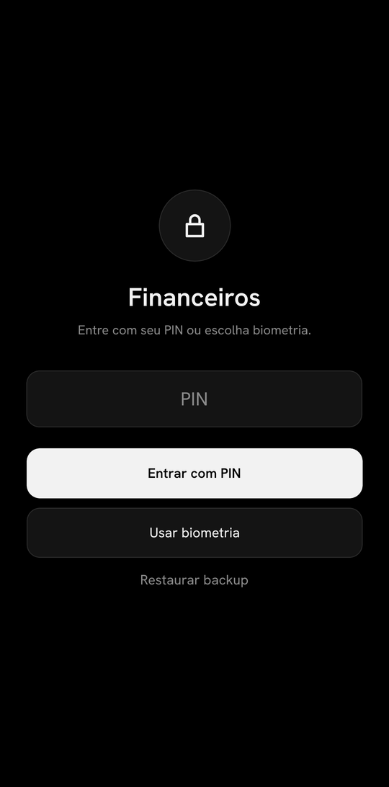
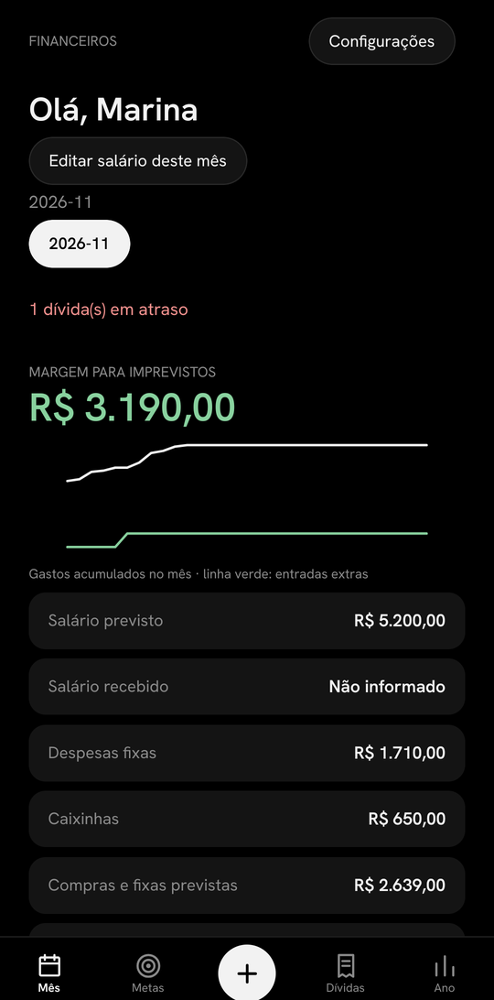
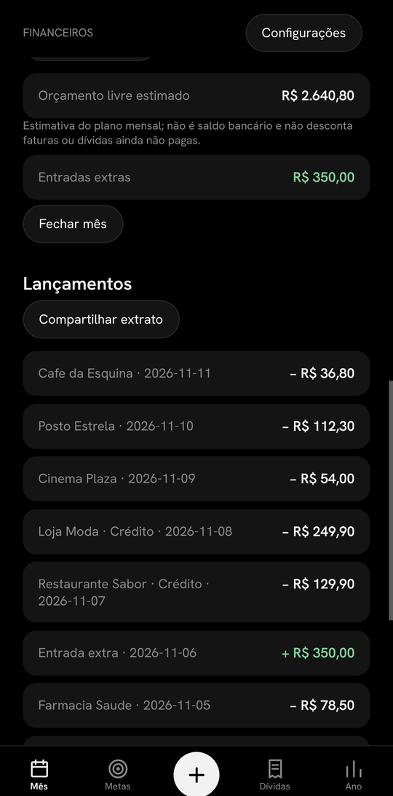
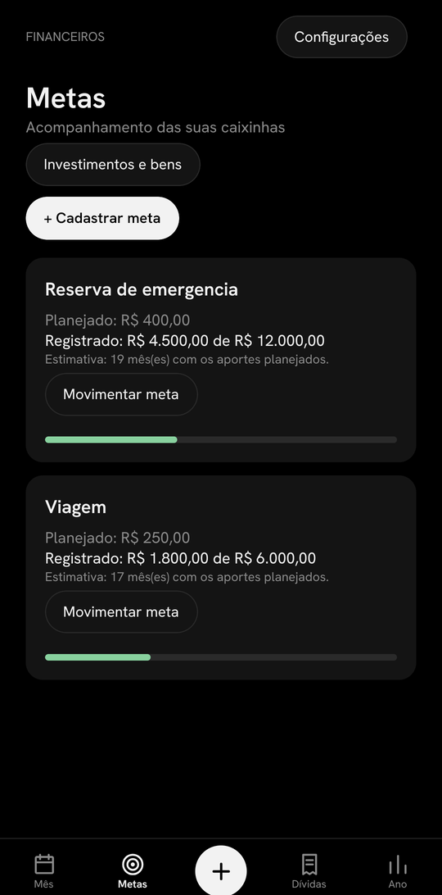
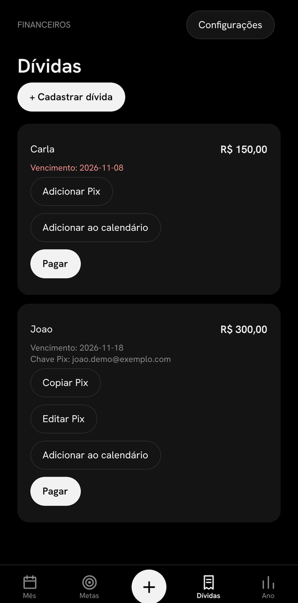
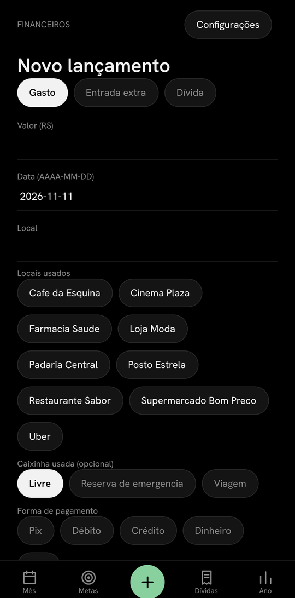
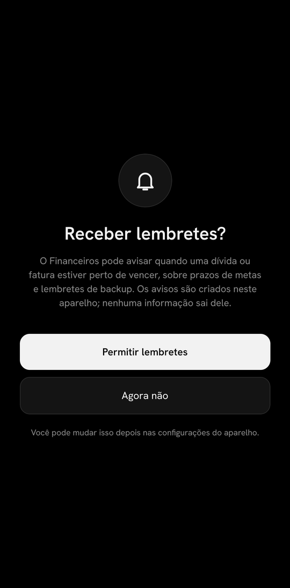

<p align="center"></p>

# Financeiro

Aplicativo de organização financeira pessoal, criado por Lorenzo. Planeje receitas e despesas, acompanhe metas, cartões e compromissos e mantenha seus dados no aparelho.

> **Versão beta:** os instaladores estão em teste. O Android já foi aberto em um aparelho; a versão de iPhone foi compilada, mas ainda não foi testada em um iPhone. Faça e confira um backup criptografado antes de depender do aplicativo. No beta atual, o nome exibido no aplicativo é **Financeiros**.

## Capturas de tela

Capturas feitas em um celular Android, com dados fictícios.

<table>
  <tr>
    <td align="center"><br><sub>Acesso com PIN ou biometria</sub></td>
    <td align="center"><br><sub>Resumo do mês</sub></td>
    <td align="center"><br><sub>Lançamentos</sub></td>
  </tr>
  <tr>
    <td align="center"><br><sub>Metas e caixinhas</sub></td>
    <td align="center"><br><sub>Dívidas e calendário</sub></td>
    <td align="center"><br><sub>Novo lançamento</sub></td>
  </tr>
  <tr>
    <td align="center"><br><sub>Lembretes (primeiro acesso)</sub></td>
  </tr>
</table>

## Downloads

Acesse a [versão beta e seus arquivos](https://github.com/LorenzoBCunha/financeiro/releases/tag/v1.0.0-beta.1):

- **Android:** [Financeiros-Android.apk](https://github.com/LorenzoBCunha/financeiro/releases/download/v1.0.0-beta.1/Financeiros-Android.apk) — baixe o arquivo no aparelho e siga as instruções de instalação do Android.
- **iPhone:** [Financeiros-iOS.ipa](https://github.com/LorenzoBCunha/financeiro/releases/download/v1.0.0-beta.1/Financeiros-iOS.ipa) — arquivo **experimental e sem assinatura**. Não instala diretamente: precisa ser assinado antes de uma tentativa de instalação.

No iPhone, uma alternativa gratuita é seguir a documentação do [AltStore Classic para Windows](https://faq.altstore.io/altstore-classic/how-to-install-altstore-windows) e tentar assinar o IPA com a própria conta Apple. Aplicativos instalados dessa maneira exigem renovação periódica, normalmente a cada sete dias. A compatibilidade desse processo com este IPA ainda precisa ser testada. Não compartilhe senhas da conta Apple.

## O que o aplicativo oferece

- Registro de ganhos, gastos, contas e dívidas, com planejamento mensal.
- Metas e caixinhas, acompanhamento de cartões e compras parceladas.
- Lembretes locais (você escolhe no primeiro acesso se quer recebê-los), análise financeira e resumo anual.
- Botão para adicionar o vencimento de dívidas e faturas ao calendário do celular. O app não acessa sua agenda: ele abre a tela de novo evento e você confirma.
- PIN ou biometria para acesso e backup criptografado com senha escolhida pela pessoa.

Não há sincronização bancária ou conta no aplicativo. Os lançamentos e saldos são informados manualmente. O compartilhamento de extratos e backups depende de uma ação da pessoa usuária.

## Cuidados e limitações

- Os dados ficam no aparelho. Guarde o backup criptografado e a senha em locais seguros e teste a restauração. Sem o arquivo e a senha, os dados podem não ser recuperáveis.
- Os fluxos de segurança, notificações, backup e restauração precisam de testes adicionais em aparelhos diferentes, especialmente no iPhone.
- Estornos de faturas já pagas ainda não estão disponíveis. Confira faturas, saldos e datas com o banco ou prestador.
- A instalação do APK fora da loja depende das configurações e regras do Android de cada aparelho.

## Integridade dos arquivos

SHA-256 para verificar que o download corresponde ao arquivo desta versão:

```text
Financeiros-Android.apk                   7c6ac4fdfd51f77492534857b599eb846cbf8fcb8ae6f7621343c928e10a6d36
Financeiros-iOS.ipa 52f30d50ddb6f4f958d999572dfc041c897dc3efbda00ae2b6814eb764edf02b
```

## Contato

Criado por Lorenzo para ajudar pessoas a organizar suas finanças. Sugestões: [Lorenzo.contato01@hotmail.com](mailto:Lorenzo.contato01@hotmail.com).
